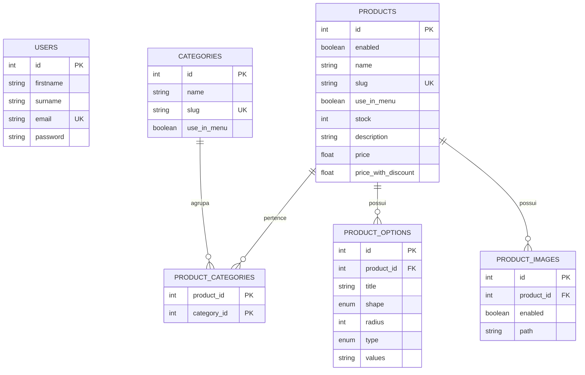

<div align="center">

# 🛍️ Digital Store

**E-commerce full stack — loja em React + API REST em Node.js e MySQL**

Projeto desenvolvido na formação **Geração Tech · Digital College** (atividades de Front-end e Back-end).


</div>

---

## 📑 Sumário

- [Sobre o projeto](#-sobre-o-projeto)
- [Tecnologias](#-tecnologias)
- [Estrutura do repositório](#-estrutura-do-repositório)
- [Como executar](#-como-executar)
  - [Pré-requisitos](#pré-requisitos)
  - [1. Back-end (API)](#1-back-end-api)
  - [2. Front-end (loja)](#2-front-end-loja)
- [Variáveis de ambiente](#-variáveis-de-ambiente)
- [Documentação da API](#-documentação-da-api)
- [Modelo de dados](#-modelo-de-dados)
- [Testes e verificações](#-testes-e-verificações)
- [Integração Front-end ↔ Back-end](#-integração-front-end--back-end)
- [Scripts disponíveis](#-scripts-disponíveis)
- [Autoria](#-autoria)

---

## 📌 Sobre o projeto

A **Digital Store** é uma loja virtual dividida em duas aplicações independentes:

| Aplicação | O que entrega |
| --- | --- |
| **Front-end** (`digital-store-frontend/`) | Interface responsiva com página inicial, listagem de produtos com filtros e ordenação, página de produto com galeria e opções, carrinho e telas de conta. |
| **Back-end** (`digital-store-backend/`) | API REST com cadastro e login (JWT), CRUD de categorias e produtos, imagens, opções de produto, busca com filtros, paginação e documentação Swagger. |

### Funcionalidades

**Front-end**
- Home com banner (slides) e coleções
- Listagem com filtros por **marca**, **categoria** e **gênero**, busca por texto (`?filter=`) e ordenação por preço
- Página do produto com galeria de imagens, seleção de tamanho/cor e produtos recomendados
- Carrinho com total em reais (BRL)
- Rotas de login/cadastro/pedidos (telas demonstrativas)
- Layout responsivo

**Back-end**
- Autenticação com **JWT** e senhas com hash **bcrypt**
- CRUD de **usuários**, **categorias** e **produtos**
- Produtos com **categorias** (N:N), **imagens** e **opções** (tamanho, cor etc.)
- Upload de imagem via URL, caminho já salvo ou **base64** (PNG, JPEG, WEBP até 5 MB, com validação de assinatura do arquivo)
- Busca por texto, faixa de preço, categorias e opções, com **paginação** e seleção de campos (`fields`)
- Operações de produto em **transação** (se algo falha, nada é gravado e as imagens enviadas são removidas)
- **Migrations** e **seeders** com Sequelize CLI
- Documentação interativa com **Swagger UI**

---

## 🧰 Tecnologias

| Front-end | Back-end |
| --- | --- |
| React 18 | Node.js 18+ e Express 4 |
| Vite 6 | MySQL com Sequelize 6 e `mysql2` |
| React Router 6 | JWT (`jsonwebtoken`) e `bcryptjs` |
| Lucide React (ícones) | Swagger UI (`swagger-ui-express`) |
| CSS responsivo | Jest e Supertest |

---

## 📂 Estrutura do repositório

```text
GeracaoTechAssessment/
├── digital-store-frontend/          # Loja em React + Vite
│   ├── index.html
│   ├── vite.config.js
│   └── src/
│       ├── main.jsx · App.jsx       # Entrada e rotas
│       ├── components/              # Header, Footer, Gallery, BuyBox, ProductCard, filtros...
│       ├── pages/                   # Home, listagem, produto, carrinho e conta
│       ├── data/products.js         # Produtos de demonstração (dados locais)
│       └── styles.css
│
├── digital-store-backend/           # API REST
│   ├── src/
│   │   ├── server.js · app.js       # Inicialização e configuração do Express
│   │   ├── config/                  # Conexão e configuração do banco
│   │   ├── routes/                  # Rotas de usuários, categorias e produtos
│   │   ├── controllers/             # Regras de cada endpoint
│   │   ├── services/                # Busca/gravação de produtos e tratamento de imagens
│   │   ├── models/                  # Modelos Sequelize e associações
│   │   ├── middleware/auth.js       # Validação do token JWT
│   │   ├── migrations/              # Criação das tabelas
│   │   ├── seeders/                 # Dados de demonstração
│   │   ├── lib/                     # Paginação, validação de query e erros
│   │   └── swagger.js               # Especificação OpenAPI
│   ├── tests/                       # Testes com Jest + Supertest
│   ├── scripts/check-syntax.js      # Verificação de sintaxe
│   ├── frontend-integration/api.js  # Exemplo de cliente HTTP para o React
│   └── uploads/                     # Imagens enviadas (servidas em /uploads)
│
├── .env.example
└── README.md
```

---

## 🚀 Como executar

### Pré-requisitos

- [Node.js](https://nodejs.org/) **18 ou superior** e npm
- [MySQL](https://www.mysql.com/) em execução (instalação local, Docker ou XAMPP)
- Git

```bash
git clone https://github.com/davicstaa/GeracaoTechAssessment.git
cd GeracaoTechAssessment
```

### 1. Back-end (API)

**1. Instale as dependências**

```bash
cd digital-store-backend
npm install
```

**2. Crie o banco de dados** (no terminal do MySQL ou no phpMyAdmin)

```sql
CREATE DATABASE digital_store CHARACTER SET utf8mb4 COLLATE utf8mb4_unicode_ci;
```

**3. Configure o ambiente** — o arquivo `.env` deve ficar dentro de `digital-store-backend/`

```bash
# Linux / macOS / Git Bash
cp .env.example .env
```

```powershell
# Windows (PowerShell)
Copy-Item .env.example .env
```

Preencha `DB_PASSWORD` (se o seu MySQL tiver senha) e defina um `JWT_SECRET` forte. Para gerar um:

```bash
node -e "console.log(require('crypto').randomBytes(32).toString('hex'))"
```

> ⚠️ A API **não inicia** sem `JWT_SECRET`. Nunca envie o arquivo `.env` ao GitHub (ele já está no `.gitignore`).

**4. Crie as tabelas, popule dados de exemplo e inicie**

```bash
npm run db:migrate
npm run db:seed      # opcional: categorias e produtos de demonstração
npm run dev          # desenvolvimento, com recarga automática (nodemon)
```

Para execução simples (sem recarga automática): `npm start`.

| Recurso | URL |
| --- | --- |
| API | http://localhost:3001 |
| Swagger (documentação interativa) | http://localhost:3001/docs |
| Health check | http://localhost:3001/health |
| Busca de produtos | http://localhost:3001/v1/product/search |

### 2. Front-end (loja)

Em outro terminal, a partir da raiz do repositório:

```bash
cd digital-store-frontend
npm install
npm run dev
```

A loja abre em **http://localhost:5173**. Para gerar e visualizar a versão de produção:

```bash
npm run build
npm run preview
```

> O front-end e a API podem rodar ao mesmo tempo: React na porta **5173** e API na **3001**.

---

## ⚙️ Variáveis de ambiente

Definidas em `digital-store-backend/.env` (modelo em `.env.example`):

| Variável | Padrão | Descrição |
| --- | --- | --- |
| `PORT` | `3001` | Porta da API |
| `NODE_ENV` | `development` | Ambiente de execução |
| `DB_HOST` | `127.0.0.1` | Host do MySQL |
| `DB_PORT` | `3306` | Porta do MySQL |
| `DB_NAME` | `digital_store` | Nome do banco |
| `DB_USER` | `root` | Usuário do MySQL |
| `DB_PASSWORD` | *(vazio)* | Senha do MySQL |
| `JWT_SECRET` | — **obrigatória** | Chave usada para assinar os tokens |
| `JWT_EXPIRES_IN` | `1d` | Validade do token |
| `CORS_ORIGIN` | `http://localhost:5173` | Origens permitidas (separe várias por vírgula) |

---

## 📖 Documentação da API

A documentação interativa completa (com exemplos de corpo de requisição) fica em **`/docs`** (Swagger UI). Resumo:

### Autenticação

Rotas marcadas com 🔒 exigem o cabeçalho:

```http
Authorization: Bearer <token>
```

O token é obtido em `POST /v1/user/token`. Token ausente, inválido ou expirado retorna **400**. Um usuário só pode alterar ou excluir a **própria** conta (outro ID retorna **403**).

### Endpoints

| Recurso | Método e rota | Auth | Descrição |
| --- | --- | :---: | --- |
| **Usuários** | `POST /v1/user` | — | Cadastrar usuário |
| | `POST /v1/user/token` | — | Login — devolve o token JWT |
| | `GET /v1/user/:id` | — | Buscar usuário (sem senha) |
| | `PUT /v1/user/:id` | 🔒 | Atualizar a própria conta |
| | `DELETE /v1/user/:id` | 🔒 | Excluir a própria conta |
| **Categorias** | `GET /v1/category/search` | — | Listar com paginação e filtros |
| | `GET /v1/category/:id` | — | Buscar por ID |
| | `POST /v1/category` | 🔒 | Criar |
| | `PUT /v1/category/:id` | 🔒 | Atualizar |
| | `DELETE /v1/category/:id` | 🔒 | Excluir |
| **Produtos** | `GET /v1/product/search` | — | Buscar com filtros e paginação |
| | `GET /v1/product/:id` | — | Buscar por ID |
| | `POST /v1/product` | 🔒 | Criar (com imagens, opções e categorias) |
| | `PUT /v1/product/:id` | 🔒 | Atualizar |
| | `DELETE /v1/product/:id` | 🔒 | Excluir |
| **Sistema** | `GET /health` · `GET /docs` | — | Status da API · Swagger |

Criações retornam **201**; atualizações e exclusões retornam **204** (sem corpo).

### Parâmetros de busca

Todas as buscas respondem no formato `{ "data": [...], "total": 0, "limit": 12, "page": 1 }`.

**`GET /v1/product/search`**

| Parâmetro | Exemplo | Descrição |
| --- | --- | --- |
| `limit` | `10` | Itens por página (padrão **12**, máximo **100**; `-1` retorna todos) |
| `page` | `2` | Página (padrão `1`) |
| `fields` | `name,images,price` | Campos retornados (`id, enabled, name, slug, use_in_menu, stock, description, price, price_with_discount, category_ids, images, options`) |
| `match` | `Tênis` | Busca no nome e na descrição |
| `category_ids` | `1,2` | Filtra por uma ou mais categorias |
| `price-range` | `100-300` | Faixa de preço (mínimo-máximo) |
| `option[ID]` | `option[45]=38,39` | Produtos cuja opção `ID` tenha algum dos valores informados |

**`GET /v1/category/search`**: `limit`, `page`, `fields` (`id, name, slug, use_in_menu, created_at, updated_at`) e `use_in_menu` (`true`/`false`).

### Exemplos

**Cadastrar e autenticar**

```bash
curl -X POST http://localhost:3001/v1/user \
  -H "Content-Type: application/json" \
  -d '{"firstname":"Maria","surname":"Silva","email":"maria@example.com","password":"Senha123","confirmPassword":"Senha123"}'

curl -X POST http://localhost:3001/v1/user/token \
  -H "Content-Type: application/json" \
  -d '{"email":"maria@example.com","password":"Senha123"}'
# → { "token": "eyJhbGciOi..." }
```

**Criar um produto** (substitua `$TOKEN` pelo token recebido)

```bash
curl -X POST http://localhost:3001/v1/product \
  -H "Authorization: Bearer $TOKEN" \
  -H "Content-Type: application/json" \
  -d '{
    "enabled": true,
    "name": "Tênis casual",
    "slug": "tenis-casual",
    "stock": 12,
    "description": "Produto de demonstração",
    "price": 199.9,
    "price_with_discount": 169.9,
    "category_ids": [1],
    "images": [{ "content": "https://images.unsplash.com/photo-1542291026-7eec264c27ff?w=600" }],
    "options": [{ "title": "Tamanho", "shape": "square", "type": "text", "values": ["38","39","40"] }]
  }'
```

**Buscar produtos**

```bash
curl "http://localhost:3001/v1/product/search?match=Tênis&price-range=100-300&category_ids=1&limit=5"
```

### Regras e validações

- **Usuário:** nome, sobrenome, e-mail válido (único) e senha com no mínimo **6 caracteres**, com `confirmPassword` igual.
- **`slug`** (categorias e produtos): apenas minúsculas, números e hífens (`tenis-casual`), único.
- **Produto:** `name`, `slug`, `price` e `price_with_discount` são obrigatórios na criação; `stock` é inteiro ≥ 0; os preços não podem ser negativos.
- **Opções:** `shape` = `square` ou `circle`; `type` = `text` ou `color`; `values` é uma lista de textos (sem vírgula dentro de cada valor).
- **Imagens:** aceita URL `http(s)`, caminho existente em `/uploads/...` ou conteúdo **base64** (`data:image/png;base64,...`) em PNG, JPEG ou WEBP de até **5 MB**. Imagens base64 são gravadas em `uploads/` e servidas em `/uploads/<arquivo>`.
- **Atualizar produto:** para alterar ou remover imagens/opções existentes, envie o `id` do item (use `"deleted": true` para remover).
- **Erros:** respostas no formato `{ "message": "..." }`; erros de validação retornam **400**, recursos inexistentes **404**.

---

## 🗄️ Modelo de dados



Todas as tabelas (exceto as de associação e imagens/opções) têm `created_at` e `updated_at`. A exclusão de um produto remove em cascata suas imagens, opções e vínculos com categorias.

---

## 🧪 Testes e verificações

No diretório `digital-store-backend/`:

```bash
npm test         # Jest + Supertest
npm run check    # verifica a sintaxe de todos os arquivos .js
```

Os testes **não precisam de banco de dados**. Eles cobrem health check, rota inexistente (404), proteção de rotas sem token, Swagger em `/docs` e as funções de paginação, IDs e `fields`.

---

## 🔗 Integração Front-end ↔ Back-end

**Estado atual:** o front-end ainda usa dados locais (`digital-store-frontend/src/data/products.js`) e **não consome a API**. Carrinho, login e cadastro são demonstrativos — o carrinho vive apenas em memória e não há pagamento real.

A API já está preparada para atender a loja. Existe um cliente HTTP de exemplo em [`digital-store-backend/frontend-integration/api.js`](digital-store-backend/frontend-integration/api.js) com `getProducts`, `getProduct`, `getCategories` e `login`. Para integrar:

1. Copie o arquivo para `digital-store-frontend/src/services/api.js`.
2. Crie `digital-store-frontend/.env` com `VITE_API_URL=http://localhost:3001`.
3. Substitua o uso de `src/data/products.js` nas páginas por chamadas a esse serviço.

---

## 📜 Scripts disponíveis

**Back-end** (`digital-store-backend/`)

| Script | Descrição |
| --- | --- |
| `npm start` | Inicia a API |
| `npm run dev` | Inicia a API com recarga automática (nodemon) |
| `npm run db:migrate` | Executa as migrations |
| `npm run db:migrate:undo` | Desfaz a última migration |
| `npm run db:seed` | Insere os dados de demonstração |
| `npm test` | Executa os testes |
| `npm run check` | Verifica a sintaxe dos arquivos |

**Front-end** (`digital-store-frontend/`)

| Script | Descrição |
| --- | --- |
| `npm run dev` | Servidor de desenvolvimento (Vite) |
| `npm run build` | Gera a versão de produção em `dist/` |
| `npm run preview` | Serve localmente a versão de produção |

---

## 👤 Autoria

Desenvolvido por **Davi** — [@davicstaa](https://github.com/davicstaa)

Projeto com fins acadêmicos, sem integração com pagamentos reais.

**Referências**
- [Projeto Front-end — Digital College](https://github.com/digitalcollegebr/projeto-digital-store)
- [Projeto Back-end — Digital College](https://github.com/digitalcollegebr/projeto-backend)
- [React](https://react.dev/) · [Vite](https://vite.dev/) · [Express](https://expressjs.com/) · [Sequelize](https://sequelize.org/)
